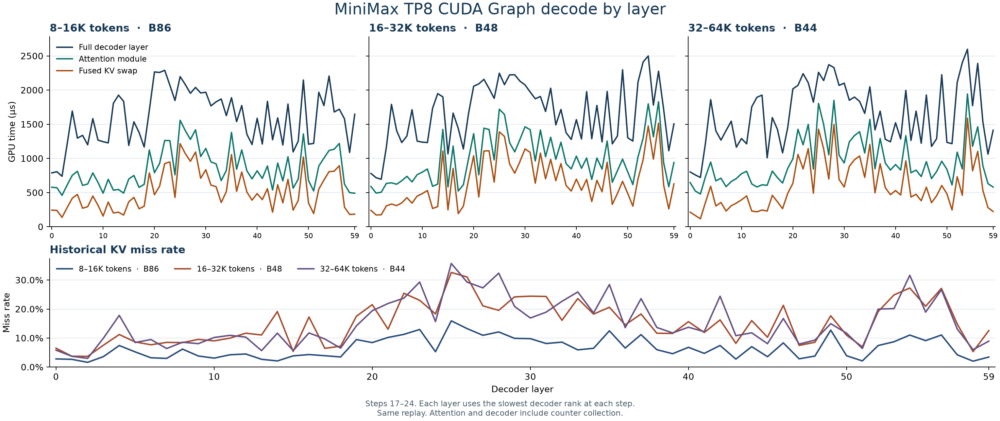
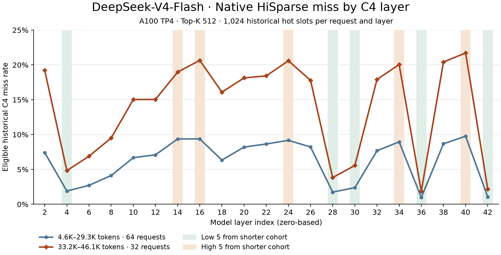
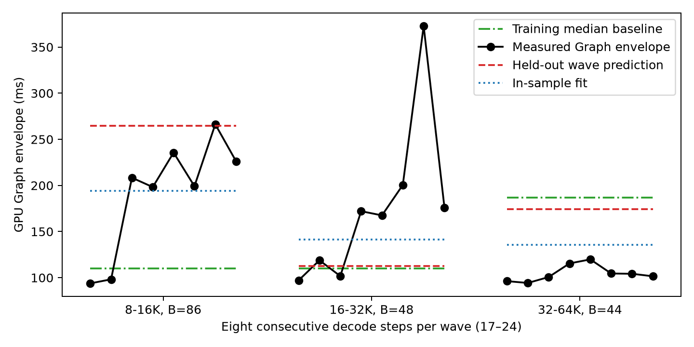

# A100 上的逐层 miss、整步耗时与 SLO 建模

## MiniMax 原生 HiSparse 的三档 CUDA Graph

同一套 MiniMax‑M3.1‑Flash、A100 TP8、BF16 主 KV、Top‑K 2048、热槽 4096。SGLang 自动确定主 KV 池，三档实际物理池均为每卡 396,544 行。每档测量第 17–24 个 decode 步，记录全部 60 层和 8 个 rank。Miss 计数和计时来自同次原生回放，计数插桩会影响覆盖它的时间。整步取八卡中最大的 Graph 首末 GPU 核时间包络。

| 输入长度 | 实际 B | 低组／高组历史 miss | 换入核差 µs/层 | Attention 差 µs/层 | 完整 decoder 层差 µs/层 | 整步中位数 ms |
| --- | ---: | ---: | ---: | ---: | ---: | ---: |
| 8–16 Ki tokens | 86 | 2.57%／12.10% | 730.44 | 732.99 | 837.17 | 203.78 |
| 16–32 Ki tokens | 48 | 6.34%／25.79% | 762.45 | 761.27 | 1,053.54 | 169.80 |
| 32–64 Ki tokens | 44 | 6.10%／28.20% | 871.04 | 872.53 | 1,035.46 | 102.89 |

高、低组各含 12 层，根据各档的历史 miss 划分。对每层每步沿用完整 decoder 时间最长的 rank，再按每步两组层的均值取差，表中是八步差值的中位数。包含换入的 attention 与 decoder 是嵌套时间。整步包络覆盖同一张卡的时间线。两种统计均保留测量边界，逐层独立取最大值不能用来估算完整一步。



再用其他长度校准波冻结的名单做离线重算。驱逐名单取 40 层时，相比预定随机 seed 13，低 miss 名单的原生换入核小计每步少 **6.19、7.03、6.58 ms**。先在各 rank 加总名单内的原生融合核，再取最慢 rank，表述为八步平均差。固定策略整模型的 TPOT 和吞吐待同预算 Graph 对照实测。

## DeepSeek‑V4‑Flash 的独立长请求留出

A100 TP4 的原生 HiSparse 覆盖 21 个 C4 层、全部 rank，Top‑K 512，每层每请求每 rank 1,024 个历史热槽。用 64 条较短请求按每层最大 rank miss 冻结高低各 5 层，用与前一批问题无重叠的 32 条长 agent 请求验证。每条测 40 步，前 8 步用于预热。

| 组别 | 实测 decode 上下文 | 低组 miss | 高组 miss |
| --- | --- | ---: | ---: |
| 选层 | 4,621–29,268 tokens | 1.61% | 9.33% |
| 留出 | 33,205–46,142 tokens | 3.66% | 20.40% |

低组为 L36、L42、L28、L4、L30，高组为 L40、L16、L14、L24、L34。32 条长请求全部同方向。对每条请求取每层最大 rank 后计算组间差，平均 **16.75 个百分点**，按请求重采样的 95% 区间 **15.41–18.16 个百分点**。这轮测量为原生 miss 诊断，固定策略的耗时影响仍待测量。



## 一步 decode 的模型检验

令 `S` 为卸载的物理 KV 层集合。对第 `r` 个 rank、第 `l` 层，按当前 batch 内的请求长度、热池容量和工作负载估计历史选择行数与 miss 率。该 MiniMax TP8 工作点每次历史 miss 每卡搬运 512 B 主 KV。最简拟合式为

```text
M[r,l] = sum_i E[历史选中行数 | 长度_i] × p_miss(i,r,l)
D[r,S] = sum_l∈S 512 × M[r,l] / W[r]
T_fit = a + b × 实际批量 + D
```

完整模型还要输入本地 KV head 与 dtype、Top‑K、实际请求长度分布和 Graph 档、索引计算、共享 PCIe 根端口与 NUMA、通信和事件就绪时间。链路独立时 `max_r D[r,S]` 给出搬运量的下界量级。对共享链路应计入争用，完整耗时按计算、回填、事件和 collective 的依赖图求最长路径。每项事件的结束时间等于自身耗时加上前驱中最晚完成时间。该形式保留可重叠的时间。图中的简单拟合只能使用可公开的逐层汇总和实际 B，各层汇总可能来自不同 rank。31.5 GB/s 是 PCIe Gen4 x16 单向理论情景。另三档 eager 数据每新增 1,000 次 miss 的边际融合核成本为 35.3–36.0 µs，对应约 14.22–14.50 GB/s 的载荷量级。图模型和实际 PCIe 吞吐需要分别校准。[NVIDIA Ampere 架构资料](https://developer.nvidia.com/blog/nvidia-ampere-architecture-in-depth/)

| 输入档与 B | 实测整步均值 ms | 全样本拟合 ms | 整档留出预测 ms |
| --- | ---: | ---: | ---: |
| 8–16 Ki / 86 | 190.73 | 194.01 | 264.50 |
| 16–32 Ki / 48 | 175.80 | 141.33 | 112.80 |
| 32–64 Ki / 44 | 104.60 | 135.78 | 174.23 |



三档共 24 个连续测量步。整档留出 MAE **71.18 ms**，简单均值基线 **70.25 ms**，最大低估 **260.16 ms**。B48 的整步包络从 97.12 ms 到 372.96 ms 时，T40 低 miss 名单的原生换入核小计从 18.71 ms 到 21.12 ms。仅凭该小计无法归因尖峰。当前拟合对象为带计数的 GPU Graph 包络，缺少配对的无插桩 TPOT 和逐层策略样本。

## 从 SLO 反推层集合

对同一真实工作负载枚举候选层集合 `S`，逐卡校验权重、索引、主 KV、热槽、暂存和 Graph 池的物理峰值，再约束稳态 TPOT 的尾部分位数及校准误差。若目标是提高并发，取满足 HBM、主机内存及 SLO 的最大可接纳 B。固定 B 时，可取同一 SLO 下净释放物理内存最多的集合。按实际集合评估，层数相同仍可能因 miss、预取与关键路径不同而有不同耗时。

```text
可行(S,B) 需要每个 rank:  M_peak[r,S,B] ≤ HBM_cap[r]
并且：q95(TPOT[S,B]) 的校准上界 ≤ SLO
```

例如假设每卡差 6 GiB，每层净省 0.5 GiB，则至少卸载 12 层。若常驻一步 80 ms、目标 110 ms、误差裕量 5 ms，剩下 25 ms。假定每层增加 2 ms 暴露等待可容纳 12 层。若每层需要 2.5 ms，则只容纳 10 层，这组假设下没有可行层数。这里参数用于演示约束。实际结论需同输入、同 B、同显存预算的原生 SGLang 与逐层策略无插桩对照，另测真实可回收页和客户端 TPOT。

[逐层和逐步匿名数值](data/a100-hisparse-graph-and-c4-20261124.json) · [工程消融合同](docs/implementation/ablation-contract.md)
