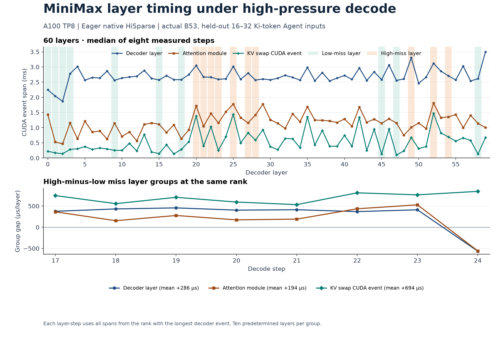

# A100 上原生 HiSparse 的 B53 逐层 decode 耗时

在 8 × A100、TP8、实际 B53 的原生 HiSparse eager 测量里，高 miss 层组比低 miss 层组的换入事件多用 **693.86 µs/层**，到完整 decoder 层平均仍多 **285.77 µs/层**。八步里有七步的完整层差为正。

## 实验与校验

使用同一批 53 条留出的 16–32 Ki token Agent 输入。Top-K 为 2,048，设备热槽为 4,096，关闭 miss 计数和 CUDA Graph。复核了全部八个 rank 的 prefill 屏障和前 24 个满批 decode 步，第 17–24 步用于计时。读回覆盖 3,840 个 rank、步、层组合。高、低 miss 层各十个，名单由另两个长度桶的历史数据事前固定。

容器监控退出后，在只读挂载中重新校验了实际进程启动参数、请求组成、每步长度和八个 rank 的调度记录，并逐条匹配了请求终态与客户端输出计数。

## 同一 rank 上的耗时分段

每个步和层先选完整 decoder CUDA event 最长的 rank，再取该 rank 的各个分段。以下是八步内高组减低组的平均差。

| 区间 | 差值（µs/层） |
|---|---:|
| KV 换入事件 | +693.86 |
| attention 去掉换入的区间 | −499.46 |
| attention 模块全段 | +194.41 |
| decoder 去掉 attention 的区间 | +91.37 |
| 完整 decoder 层 | **+285.77** |

完整层平均保留了约 **41.2%** 的换入事件差，逐步差值在 −567.60 到 +455.37 µs/层之间。每步取八 rank 最大的完整 forward event，八步中位数为 **222.60 ms**。CUDA event 区间也包含事件之间同流的空档与等待。图中各层曲线上使用的 rank 可随层和步改变。

B32 的 Graph 测量使用另一批校准输入，采集范围从换入核到 attention merge。判定 eager 对同一工作负载的影响还需要匹配请求、并发和计时边界。固定低 miss 层与随机层的无插桩 TPOT 与吞吐留给实际策略对照。 [B32 Graph 测量](NATIVE_GRAPH_20261123.md)
