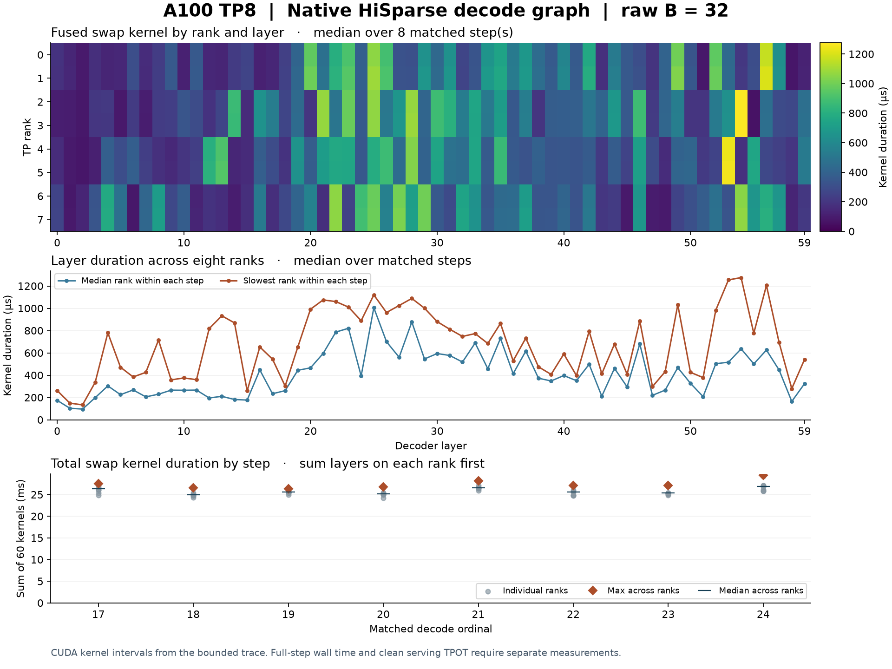

# A100 上原生 HiSparse 的逐层 Graph 换入耗时

MiniMax 在 8 × A100、TP8 和实际 B32 下，事前选出的高 miss 层组比低 miss 层组的换入核平均多用 **787.62 µs/层**。测量对象为启用原生 HiSparse 的 CUDA Graph 回放。该结果用于核查层间换入开销的差异。

## 实验条件

使用 32 条 16–32 Ki token 输入的 agent 校准请求，每条生成 64 个 token，合计 2,048 个输出 token。稀疏 Top-K 为 2,048，设备热槽为 4,096，主机与设备容量比为 4。Graph 实际物理 KV 容量为 396,544 行，历史 clean 波为 396,800 行。按本次容量重新验算后，两次的请求组成与预算一致。八个测量步为 decode 第 17–24 步，前后各有一个保护步。

离线用 Nsight Systems 2026.3 导出采集记录，逐 rank 核对实际回放位置及每步 60 个有序的换入核。有效覆盖 64 个 rank-step 和 3,840 个 rank-step-layer 组合。高、低 miss 组各十层，名单由另两个上下文长度桶的历史 miss 在本次采集前固定。

## 换入核与整图时长

| 指标 | 实测值 |
|---|---:|
| 高 miss 组换入核耗时 | 1,065.88 µs/层 |
| 低 miss 组换入核耗时 | 278.26 µs/层 |
| 高组相对低组的差值 | 787.62 µs/层 |
| 最短和最长的层 | L2 为 133.41 µs，L54 为 1,274.92 µs |
| 每步最慢 rank 的整图 kernel 区间 | 71.15 ms |
| 每步先按 rank 累加 60 个换入核再取最大 | 27.08 ms |

每一步先对每层取八 rank 里的最大换入核时长，再取八步中位数。分组数值为组内十个层中位数的平均。两个整步指标各取八步中位数。整图区间由每 rank 的第一个到最后一个 GPU kernel 界定，包含其中的空档。换入核包含索引查找、LRU 和缺失 KV 的读取。直接把各层的最大值相加会混合不同 rank。

这次结果来自一个校准输入批次。相邻 attention 内核配对未通过自动验收，完整 decoder 层和已暴露的换入等待还需单独核对。固定低 miss 层与随机层的策略收益需要在同显存、同并发、同输入下测量无插桩 TPOT 和吞吐。独立 eager 窗口见 [11 月 22 日实验报告](REPORT_20261122.md)。
