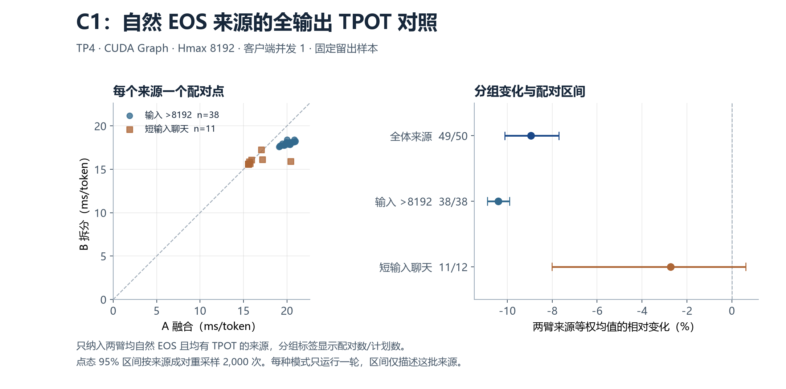
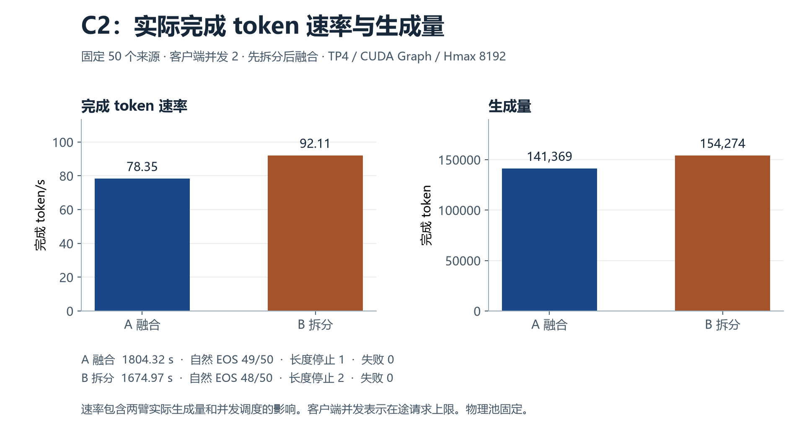

# HiSparse 活跃容量与换入路径实验报告

本研究检验请求类型、输入长度和层间 KV 复用差异是否足以支持不同的 GPU hot buffer 活跃容量，并独立测量固定容量下的 KV 换入路径。实验采用 SGLang、MiniMax M3.1 Flash 和 A100。容量回放与真实服务测试各自固定模型和 Top-K 规则。真实运行保持同一物理缓存池。

数据来自 [WildChat-1M](https://huggingface.co/datasets/allenai/WildChat-1M)（revision 7d6490e462285cf85d91eabea0f9a954fbddcd1f）、[SWE-agent trajectories](https://huggingface.co/datasets/nebius/SWE-agent-trajectories)（68195a1450865274106246d0d0296a1d6807b88e）和 [LongBench-v2](https://huggingface.co/datasets/zai-org/LongBench-v2)（2b48e494f2c7a2f0af81aae178e05c7e1dde0fe9）。分别使用真实对话前缀、工具轨迹文本回放和完整长文问题。没有执行轨迹中的工具，也没有拼接无关文本扩充输入。LongBench 使用本轮容量配置下可运行的子集，本报告不提供官方 benchmark 准确率或闭环 agent 解题成绩。

服务使用固定 SGLang 实验镜像及同一 A100 适配路径。双方保持相同权重与精度设置，Top-K 为 2048。实验使用同四张卡，整台服务器并未专用，其他 GPU 仍有任务。报告发布匿名统计；原始对话、生成 token 和访问轨迹保留在私有实验空间。

## 150 条真实轨迹

完整记录含 150 个来源，每类 50 个。144 条自然 EOS，6 条到达配置容量边界后停止。停止前的记录保留作敏感性分析，停止后的生成没有观测。主分析使用自然 EOS 来源。

原生 hot 4096 的 miss 率按rank 0、六个采样层、排除每条轨迹开始的 16 个 decode 步汇总。有预热后有效选择的来源才进入 miss 统计，表中单列有效来源数。请求等权先计算每个请求的比率再平均，选中 token 加权用总 miss 除以总有效选择。

| 负载 | 记录数 | 自然 EOS | 容量停止 | 有效来源 | 请求等权 miss | 选中 token 加权 miss |
| --- | --- | --- | --- | --- | --- | --- |
| 聊天 | 50 | 45 | 5 | 45 | 0.590% | 2.330% |
| 工具调用型 agent | 50 | 50 | 0 | 50 | 2.449% | 13.974% |
| 长文档 | 50 | 49 | 1 | 49 | 8.842% | 8.922% |

一个较长的 agent 请求占该类 56.48% 的有效选择。三类的输入长度、生成长度和实际上下文分布不同。类型均值受长度与选择量影响，归因需同长度比较。后续留出回放同时报告只使用输入长度的策略。

## 同轨迹容量回放

冻结来源划分为训练 60、留出 90。自然 EOS 回放实际使用训练 58、留出 86 个来源。固定 rank 0/1 和零基层号 5、15、25、35、45、55，对同一真实选择轨迹按 LRU 回放。六层的每请求逻辑容量总和固定为 24,576 槽。训练来源用于拟合，留出来源只用于评分。

| 策略 | 留出加权模拟 miss | 相对统一容量的 miss 减少 |
| --- | --- | --- |
| 统一 4096 | 5.3951% | — |
| 共用逐层表 | 4.8875% | 9.41% |
| 按类型逐层 | 4.8687% | 9.76% |
| 按输入长度逐层 | 4.8719% | 9.70% |

共用表按层容量为 3,584、3,584、5,120、5,120、4,096、3,072 槽。L45 与其余 54 个未采样层保持 4096，全模型实际改变 5/60 层。六层、两采样 rank 的留出模拟 miss 次数相对统一 4096 减少 **9.41%**，绝对减少 0.5075 个百分点。2,000 次来源配对 bootstrap 的点态 95% 区间为 [0.3065, 0.7302] 个百分点。按类型进一步减少 0.0188 个百分点，区间 [-0.0447, 0.0809] 跨零。长度策略与类型策略的留出结果接近。纳入容量停止轨迹的敏感性分析在同一来源划分上重新拟合，留出有效来源为 90。

## 真实缓存语义与 eager 容量试跑

在真实 MiniMax TP4 的 60 层上，同一次调用以相同缓存前态比较原生与恒等配置，**352,080** 次调用的输出位置、K/V 字节和元数据一致。统一活跃 4096 与训练共用表另外通过 **383,280** 和 **352,800** 次选中 K/V 与 LRU 检查，包含真实请求槽位释放和复用。拆分路线在单卡、无模型的独立 CUDA 验证中通过 48 个配置和 2,304 次同状态对照，覆盖 eager、CUDA Graph 和 fused 回退。

原生服务使用相同非流式输入重复生成时也出现了 token 分歧，最早在第 8 个生成 token。真实同前态检查支持观察调用上的缓存语义正确性。生成可重复性和任务准确率仍需各自的证据。

在相同物理 Hmax=8192、TP4、客户端并发 1 下，两个训练来源分别以统一活跃 4096 和共用逐层表运行一次 eager 无插桩对照。两侧均为 2/2 自然 EOS，输出分别为 511 和 462 token。全程 TPOT 为 124.71 → 127.21 ms/token，第 8–32 token 窗口为 132.32 → 131.78 ms/token，完成 token/s 为 7.66 → 7.52。各指标变化方向不同，这轮未观察到一致收益。

## 固定容量下拆分换入

独立 eager profile 在一个长训练输入上采集 16 个 decode 步，各 rank 的 HiSparse 换入 kernel 耗时和折合 3.26–3.38 ms/步。这个量同时包含查找、驱逐和搬运，不能视为 H2D 或 TP 关键路径时间。

原 fused 路径每请求由一个 CTA 执行 miss 规划和搬运。拆分路线复用 SGLang 已有的 miss-plan 与 copy 内核，把同一 stream 上的顺序改成 **规划 → 64 CTA 拷贝 → attention**。小 batch 有较多 miss 时，更多 CTA 可以同时搬运。零 miss 时增加一次 launch。运行时仅对指定层及 batch 形状 1/2 使用拆分，其他情况走原 fused 路径。两步与 attention 仍按序执行。

适配器在每个 rank 预分配并跨层复用两行换入计划。源地址、目标槽位和计数的逻辑张量存储合计 48 KiB + 8 B；这个数不等于 allocator 最终保留的显存。KV 池配置保持不变，拆分路线另有这份暂存开销。

规划与拷贝机制来自 SGLang 现有的 [HiSparse CUDA 内核](https://github.com/sgl-project/sglang/blob/main/python/sglang/kernels/jit/csrc/kvcacheio/hisparse.cuh) 和 [Python 接口](https://github.com/sgl-project/sglang/blob/main/python/sglang/kernels/ops/kvcache/hisparse.py)。本次工作是将该路径接入并验证特定 MHA 配置，不将已有内核作为原创算法。

| 单卡合成 Graph batch | 每请求 miss | 融合中位数 / μs | 拆分中位数 / μs |
| --- | --- | --- | --- |
| 1 | 0 | 26.6 | 29.2 |
| 1 | 512 | 89.1 | 42.0 |
| 2 | 512 | 91.1 | 52.2 |
| 8 | 512 | 113.7 | 115.7 |

微基准恢复相同缓存前态，只比较该操作。B8 行用于观察扩展边界，当前运行时 B8 使用融合。正式候选的 60 层都采用统一活跃 4096，层名单覆盖 60 层。物理 Hmax 与 KV 池保持固定。

## 训练复测

两个训练来源在 TP4、客户端并发 2、CUDA Graph 下按 A1/B1/B2/A2 各运行，A 是 fused，B 是 split。按来源等权的第 8–32 token 窗口均值为 **22.703 → 19.905 ms/token（-12.3%）**。三档 SLO 的达标数相同。每种实现汇总两轮，共四次响应，只来自两个独立来源。此结果用于冻结候选和留出协议。

| TTFT / TPOT 上限 | A 自然 EOS 达标 | B 自然 EOS 达标 |
| --- | --- | --- |
| 5 s / 50 ms | 3/4 | 3/4 |
| 5 s / 100 ms | 4/4 | 4/4 |
| 5 s / 150 ms | 4/4 | 4/4 |

## 50 源独立留出实测

样本在运行前按输入筛选，包括 8 条长输入 agent、30 条长文档和 12 条短输入聊天。长输入超过 Hmax=8192，聊天控制在到达时较短，生成中可能跨过 Hmax。四轮按 C1-A、C1-B、C2-B、C2-A 执行，C1/C2 分别指客户端在途上限 1/2。A 为融合，B 为拆分。两侧全层活跃容量均为 4096，采用相同输入、预算、TP4、decode CUDA Graph bucket 1/2 和物理池。服务端关闭 prefill graph、scheduler overlap 和 Radix。各轮均无插桩，并保留自然 EOS 与原容量停止条件。

### C1 的全程 TPOT

主指标纳入两侧均自然 EOS 且均有 TPOT 的来源，对来源等权。B 相对变化是 B 均值除以 A 均值再减 1。负数表示延迟下降。

| 输入分组 | 有效配对 / 计划 | A / ms/token | B / ms/token | B 相对变化 | 配对 95% 区间 |
| --- | --- | --- | --- | --- | --- |
| 全部 50 源 | 49/50 | 19.23 | 17.51 | -8.9% | [-10.1%, -7.7%] |
| 输入 >8192 的 38 源 | 38/38 | 20.06 | 17.98 | -10.4% | [-10.9%, -9.9%] |
| 12 个短输入聊天来源 | 11/12 | 16.36 | 15.91 | -2.7% | [-8.0%, +0.6%] |

### 整轮时间、生成量和 SLO

完成 token/s 以成功流的输出计数除以整轮 makespan。失败流的已观察 token 单列。自然 EOS 请求 goodput 是 EOS 数除以整轮 makespan。C2 的 B 相对 A 完成时间变化为 **-7.2%**，完成 token/s 变化为 **+17.6%**。生成量、生成轨迹及并发调度都会影响整轮速率。

C2 的首 token 延迟 p95 为 A **6.32 s**、B **12.55 s**。本轮拆分版的首 token 尾延迟更高，应与下表达标请求数一起看，不能用完成 token 速率代替所有服务质量指标。

| 运行 | 整轮时间 | 完成 token | 失败流已观察 token | 完成 token/s | 自然 EOS 请求/s | 自然 EOS | 长度停止 | 失败 |
| --- | --- | --- | --- | --- | --- | --- | --- | --- |
| C1 A 融合 | 2987.54 s | 145,213 | 0 | 48.61 | 0.0164 | 49/50 | 1 | 0 |
| C1 B 拆分 | 2179.47 s | 119,086 | 0 | 54.64 | 0.0225 | 49/50 | 1 | 0 |
| C2 A 融合 | 1804.32 s | 141,369 | 0 | 78.35 | 0.0272 | 49/50 | 1 | 0 |
| C2 B 拆分 | 1674.97 s | 154,274 | 0 | 92.11 | 0.0287 | 48/50 | 2 | 0 |

SLO 阈值在留出计时前冻结。每档同时满足 TTFT 和 TPOT 才计达标。严格自然 EOS SLO 以每臂全部 50 个计划请求为分母，缺指标、失败和长度停止均计未达标。

| 并发 | TTFT / TPOT 上限 | A 达标 | B 达标 | A 达标请求/s | B 达标请求/s |
| --- | --- | --- | --- | --- | --- |
| C1 | 5 s / 20 ms | 28/50 | 49/50 | 0.0094 | 0.0225 |
| C1 | 5 s / 25 ms | 49/50 | 49/50 | 0.0164 | 0.0225 |
| C1 | 5 s / 50 ms | 49/50 | 49/50 | 0.0164 | 0.0225 |
| C2 | 5 s / 50 ms | 44/50 | 42/50 | 0.0244 | 0.0251 |
| C2 | 5 s / 100 ms | 44/50 | 42/50 | 0.0244 | 0.0251 |
| C2 | 5 s / 150 ms | 44/50 | 42/50 | 0.0244 | 0.0251 |

### 固定窗口与其他配对

第 8–32 token 窗口为两次独立单 token SSE 到达时间差除以 24。短输出、端点合并和失败按原因排除。固定位置比较仍受输出轨迹差异影响。

| 次指标 | 有效配对 / 计划 | A / ms/token | B / ms/token | B 相对变化 | 配对 95% 区间 |
| --- | --- | --- | --- | --- | --- |
| C1 第 8–32 token 窗口 | 50/50 | 19.13 | 17.41 | -9.0% | [-10.2%, -7.6%] |
| C2 自然 EOS 全程 TPOT | 48/50 | 22.21 | 19.89 | -10.5% | [-14.3%, -6.7%] |
| C2 第 8–32 token 窗口 | 50/50 | 21.09 | 18.95 | -10.1% | [-12.2%, -8.3%] |

区间为 2,000 次来源配对 bootstrap 的描述性点态 95% 区间，未校正多重比较。每种并发每个实现只有一整轮留出运行，区间不含跨运行波动。并发运行中各请求也共享调度。该样本按输入条件筛选，结论限于本次负载、模型和执行配置。

## 当前结论与后续自动化

等逻辑预算的六层回放显示了容量重分配的收益。两个训练输入的 eager 试跑没有表现出一致的端到端收益。固定统一活跃容量下的拆分换入是独立实测干预，C1 自然 EOS 全程 TPOT 的配对变化为 -8.9%，C2 的整轮结果见上。物理 Hmax=8192、缓存池 32,768 token，本轮没有回收显存或扩展可接纳请求数。

当前自动化仅在训练来源上用离散容量曲线拟合静态表。拟合在固定总逻辑槽预算下最小化合计模拟 miss，随后冻结表并用留出评分。下一步应拟合每页容量带来的时间收益，将可减少的换入字节、查找成本、不同 batch 形状和重映射开销一并纳入。若加入在线调整，需先验证最小容量、读取与迁移的 stream 顺序、各 TP rank 的配置一致性和请求槽位生命周期，再用迟滞与最短保持时间抑制频繁切换。在线切换尚未实现。
