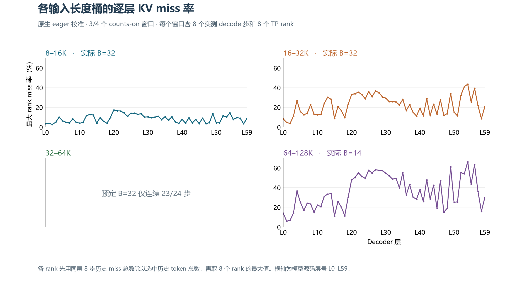
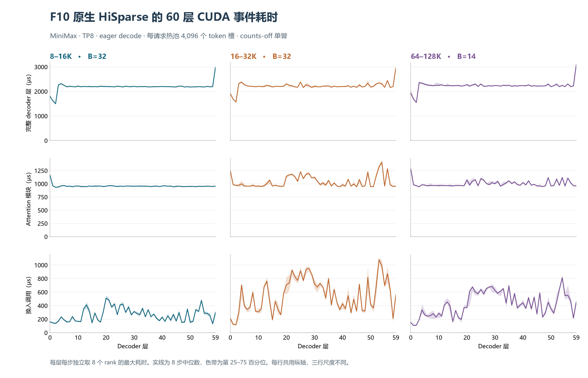

# MiniMax 在八张 A100 上的逐层 KV 未命中与 decode 耗时

原生 HiSparse 的高 miss 层确实花更多时间换入 KV。16–32 Ki 输入、32 条 agent 请求同时解码时，高低两组的换入调用相差 **595 µs/层**，完整 decoder 层的中位差为 **194 µs/层**，个别步方向相反。要判断按层驱逐是否值得，仍缺关键的直接对照：在相同显存、请求、实际并发和 CUDA Graph 设置下运行低 miss 选层和随机选层，比较实际 TPOT 与输出吞吐。

## 层间差距有多大

模型为 MiniMax-M3.1-Flash，使用 SGLang、TP8、60 个稀疏注意力层、Top-K 2,048 和每请求每层 4,096 个热槽。输入来自 SWE-agent 轨迹。下表左侧来自开启计数的 eager 运行。对每一层，各 rank 先将八个测量步的历史未命中数除以对应的有效历史选择总数，再在八个 rank 中取最大比值。该 rank 随层变化。

| 输入长度 | 实际 decode 并发 | 60 层的最大 rank miss 率范围 | 低 miss 组换入（µs/层） | 高 miss 组换入（µs/层） | 同一步高减低（µs/层） |
|---|---:|---:|---:|---:|---:|
| 8–16 Ki | 32 | 2.76%–17.41% | 155.2 | 368.6 | 218.3 |
| 16–32 Ki | 32 | 3.65%–43.54% | 235.6 | 842.5 | 594.7 |
| 64–128 Ki | 14 | 5.89%–66.06% | 223.3 | 590.7 | 374.1 |

右侧来自另一次关闭 miss 计数、保留 CUDA event 的 eager 运行。每个长度档都用另外两个校准档确定高、低各 10 层，在目标档的同一 decode 步内比较。每层先取八个 rank 中最长的调用，再对组内各层取均值。三列分别取八步中位数，因此最后一列不等于前两列简单相减。三个窗口各有 16 步预热、8 步测量，24 个测量步中高组的换入调用均更慢。32–64 Ki 的指定 B32 计数窗口只连续保持了所需 24 步中的 23 步，未计入此表。每档只有一波校准请求，计数和计时两次运行的前缀也未逐请求完全配对。

## 为什么不能把换入差直接当作整步收益

CUDA event 记录 GPU 流上两个事件的时间跨度，可能包含提交空档及等待。每层的换入、attention 和完整 decoder 是嵌套范围，各指标最慢的 rank 可以不同。在 16–32 Ki / B32 窗口，完整名单的高低层组在完整 decoder 上相差 193.6 µs/层，八步范围为 −938.5 至 +274.9 µs/层。去掉 L0–2 和 L59 再算，换入差仍有 561.3 µs/层，完整 decoder 层差的中位数降至 72.4 µs/层。现有事件不足以确定差距缩小的原因。

**对固定层数的估算。** 在同一 16–32 Ki / B32 原生全层运行中，对已经发生的换入调用评分。每步先在同一 rank 内累加选中层的时间，再在八个 rank 中取最大值。随机名单与从其他长度档冻结的低 miss 名单逐步相减。下列单位为每步毫秒，表中为八步中位数。

| 转入热池的层数 | 随机种子 13 减低 miss | 随机种子 37 减低 miss | 随机种子 71 减低 miss |
|---|---:|---:|---:|
| 40 / 60 | 3.36 | 4.54 | 2.46 |
| 50 / 60 | 1.56 | 2.09 | 0.65 |

同窗完整 forward 的独立事件中位数为 137.57 ms。40 层名单的差额相当于这段**原生全层**耗时的约 1.8%–3.3%。真实混合策略会改变完整驻留的层数、显存分配和关键路径；其整步时间要重新测量。现阶段尚未实测到目标中的 5% decode 加速。

## 独立留出请求的原生压力基线

原生 TP8 服务共处理 449 个不同来源，114 个用于校准，335 个用于留出。下表全为留出数据，K 档按 1,024 个输入 token 换算。最大 B 取自八个 rank 对齐的实际调度记录。交付速率从本波所有请求均收到首 token、且至少一个请求收到第二个 token 后开始计数，按各波交付量之和除以窗口总时长。

| 初始输入 | 波数 | 独立来源 | 最大实际 B | 客户端 decode 窗口交付（token/s） |
|---|---:|---:|---:|---:|
| 8–16 Ki | 2 | 128 | 64 | 795.68 |
| 16–32 Ki | 3 | 128 | 53 | 464.49 |
| 32–64 Ki | 2 | 78 | 43 | 418.80 |
| 64–128 Ki | 1 | 1 | 1 | 55.11 |

生成上限为每请求 64 token，335 条留出请求中有 329 条触及上限。最长档只有一个来源。整卡 NVML 在 1,077 轮八卡采样中的逐卡峰值为 91.66%–92.37%；此数包含权重、预分配池和工作区。表中的客户端交付速率与上面的 eager 分层诊断来自不同跑次，不能用两者相除计算加速比。

匿名数据包含三档的逐层 rank 计数、计时曲线的八步数据、分组名单、随机选层的逐步差额和基线分子分母。[数值附表](data/a100-minimax-20261122.json)
