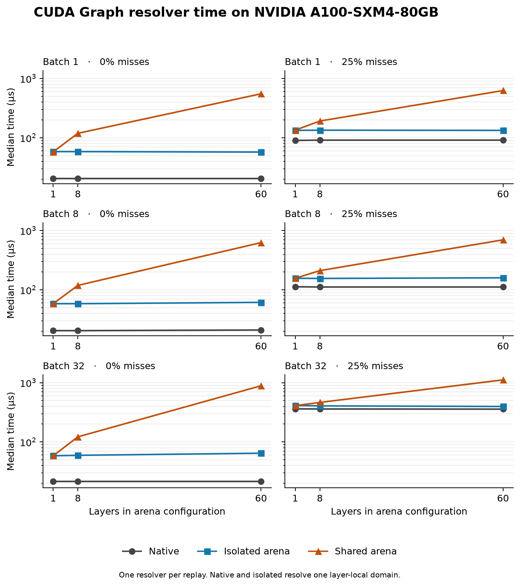

# A100 上共享 LRU 全池扫描的单核实测

2026-11-24，在一张 NVIDIA A100-SXM4-80GB 上，每个请求从 60 层共享域选取 2,048 个已驻留 token 时，B32 的完整 resolver 中位耗时为 **885.760 µs**。相同选集和初态下，原生为 **21.504 µs**，隔离 arena 为 **64.512 µs**。当每个请求有 512 个 token 需要换入时，三臂经初态及返回位置校验的逻辑换入 payload 均为 8 MiB K/V（不是硬件计数器测得的 PCIe 字节），原生、隔离、共享分别为 **357.376、396.288、1,114.112 µs**。全命中时共享域仍有明显代价，优化可以先从无需主机换入的路径入手。[54 组实测与全部采样](../../results/shared-lru-scan-a100-20261124/scan-main-01.json)

## 共享域从 1 层扩大到 60 层

下表为 B32，每个数字均为单次完整 resolver 的中位耗时，单位为 µs。每层有 4,096 个热槽。配置层数只在 shared 模式下扩大单请求的查找与淘汰范围。

| 配置层数 | 每请求 miss 比例 | 原生 | 隔离 arena | 共享 arena |
|---:|---:|---:|---:|---:|
| 1 | 0% | 21.504 | 58.368 | 58.368 |
| 8 | 0% | 21.504 | 59.392 | 121.856 |
| 60 | 0% | 21.504 | 64.512 | 885.760 |
| 1 | 25% | 361.472 | 411.648 | 409.600 |
| 8 | 25% | 359.424 | 406.016 | 463.872 |
| 60 | 25% | 357.376 | 396.288 | 1,114.112 |

单层全命中时，两个 arena 的耗时相同，均高于原生。扩至 60 层后，全命中时共享耗时为隔离的 13.73 倍，25% miss 时为 2.81 倍。相同方向也出现在 B1 和 B8。60 层全命中时，共享耗时分别为 551.936 和 626.688 µs，隔离分别为 57.344 和 61.440 µs。



### B32 逆序复测

固定 60 层和 B32，把执行顺序改为共享、隔离、原生，仍预热 5 次、计时 50 次。全命中和 25% miss 均复现原有耗时排序。补测的 100% miss 工况中，每请求换入 2,048 行，全批次读取 32 MiB K/V，共享耗时为 2,141.184 µs。[逆序复测与逐次采样](../../results/shared-lru-scan-a100-20261124/scan-reverse-02.json)

| 每请求 miss 比例 | 原生 (µs) | 隔离 arena (µs) | 共享 arena (µs) |
|---:|---:|---:|---:|
| 0% | 18.432 | 54.272 | 894.976 |
| 25% | 359.424 | 401.408 | 1,117.184 |
| 100% | 1,373.184 | 1,418.240 | 2,141.184 |

## 计时和可比条件

- 使用 PyTorch 2.15.0.dev20261005+cu134、CUDA 13.4。固定每个 TP rank 一个 BF16 KV head，head dimension 为 128，每个 K 或 V 行 256 字节。上下文为 6,400 个 token，选取 16 个互异的 128-token 块。每个被测请求均进入长序列路径。
- 三臂均运行完整的 MHA swap-in。原生调用固定版本的 `load_blocks_to_device_buffer_mha`，传入 coordinator 的 `block_size=960`、`page_size=1`。隔离和共享调用同一个 arena resolver，均为 1,024 线程、每请求一个 CTA、LRU 淘汰、关闭诊断计数。设备池的 128-token page 与原生 swap-in 参数分别用于分配和寻址。
- 每例先执行并校验一次 eager launch，再用 CUDA Graph 重放。图内两个 external CUDA event 包住一次 resolver。每轮重放前恢复反向 token 表和 LRU 元数据，并把上次换入行的 K/V 恢复为初始哨兵值。监测点核对输出归属、反向映射以及每个返回槽位的 K/V 字节。报告中的命中和 miss 数由初态及返回位置验证得到。
- 批量取 1、8、32，配置层数取 1、8、60，每请求 miss 数取 0 或 512。每个组合预热 5 次，保留其后 50 次采样，共 54 组、2,700 个计时值。初始化、恢复、输出校验与 Python 调度均在事件区间之外。[基准实现](../../runtime/benchmark_shared_lru_scan.py)
- 合成数据使用连续的物理槽位，每轮恢复会触及元数据，三臂的 L2/TLB 初态可能不同。原生只分配被测层，两个 arena 分配配置的全部设备层，全都只给被测层分配 pinned 主机历史。在 L60、B32 下，原生设备 K/V 为 66.06 MiB，两个 arena 各为 3,963.75 MiB，三者的 pinned 主机历史各为 100 MiB。相同层数下比较两个 arena，可控制设备 K/V 容量；这些显存数值描述本夹具的分配。
- 这组数据固定选集和 miss 数，只覆盖单 rank 单层的一次 resolver 调用。模型的实际跨层命中收益、attention、通信、排队、TPOT 和吞吐需要另外测量。

同一 A100 环境使用真实 NVCC 编译 shared resolver，通过生产几何的全部 60 层正确性检查。eager 与 CUDA Graph 各执行 66 次，分别覆盖两个请求 generation，并同参考实现逐项比较状态与 K/V。整个实验未加载模型。[正确性结果](../../results/shared-lru-scan-a100-20261124/gate-production-01.json) [镜像、源码与运行清单](../../results/shared-lru-scan-a100-20261124/manifest.json)

## 源码中随域扩大而增长的工作

**命中查找遍历整个域。** 设每请求的域有 D 行。在阶段 3，CTA 读取整个 recency 列表，再按行号取 owner。仅当 owner 匹配本请求的 generation 和被测层时，才读取反向 token 并查询共享内存哈希表。L60 下隔离域 D 为 4,096，共享域 D 为 245,760。域扩大 60 倍，每个请求仍只交给一个 CTA。[阶段 3](../../runtime/shared_lru_kernel.cuh#L315)

**LRU 顺序更新又遍历一次完整域。** 阶段 9 保留未触及行的相对顺序，把触及的行按行号移至结尾。当前实现每 1,024 行处理一块，对 keep 标记做 CTA 前缀和，用前一块的累计写位置原地压缩。每块含 5 次显式 CTA 屏障。隔离域需要 4 块、20 次屏障，共享域需要 240 块、1,200 次屏障。仅计阶段 3 和 9 的 recency、owner 的逻辑读取以及 recency 写回，共约 20D 字节，即 L60、B32 约 150 MiB 的表访问。实际片外流量取决于缓存命中、合并访存及写回行为。[稳定压缩](../../runtime/shared_lru_kernel.cuh#L481) [CTA 前缀和](../../runtime/shared_lru_kernel.cuh#L98)

**有些成本取决于选宽和初态。** 2,048 项 bitonic 排序有 66 轮，与域层数无关；选择去重、哈希及触及行计数也增加两个 arena 的工作。victim 扫描找够即停。在本夹具的 L60 初态中，共享 resolver 请求最后一层，域开头都是其他层的行，首块就可提供所需的 512 个 victim。全命中时阶段 4 跳过候选扫描，阶段 9 仍会更新 recency。源码能确定这些工作量，其各自占用的微秒数需要单独测量。[排序](../../runtime/shared_lru_kernel.cuh#L169) [victim 扫描](../../runtime/shared_lru_kernel.cuh#L327)

## Nsight 核验

Nsight Systems 2026.3 在 L60、B32 的全命中和 25% miss 两种工况下，对每臂分别记录到 1 次 eager 调用与 13 次 graph 调用。每次 replay 的 GPU 时间线上只有一个 resolver kernel。原生的 grid 有 32 个 CTA，每个 CTA 为 960 线程，动态共享内存为 42,000 字节，每线程 56 个寄存器。两个 arena 的 grid 同为 32 个 CTA，每个 CTA 为 1,024 线程，动态共享内存均为 100,904 字节，每线程 58 个寄存器。[Nsight Systems 调用次数、几何与逐次时间](../../results/shared-lru-scan-a100-20261124/nsys-summary.json)

| 工况 | 原生 kernel 中位数 (µs) | 隔离 kernel 中位数 (µs) | 共享 kernel 中位数 (µs) |
|---|---:|---:|---:|
| 全命中 | 17.152 | 61.440 | 891.166 |
| 25% miss | 355.455 | 399.615 | 1,109.854 |

### Nsight Compute

Nsight Compute 2026.3 在 L60、B32、全命中条件下，为每臂采集 1 个 graph resolver，各用 14 个 profiling pass，采用默认缓存控制、关闭 profiler 时钟控制。硬件计数权限由实验专用的 SYS_ADMIN 容器提供，主机驱动沿用原配置。下表列出该次 profile 的硬件指标，性能比较仍使用前面的独立 event 计时。[原始指标名与单位](../../results/shared-lru-scan-a100-20261124/ncu-summary.json) [采集环境和原始报告摘要](../../results/shared-lru-scan-a100-20261124/manifest.json)

| 硬件指标 | 原生 | 隔离 arena | 共享 arena |
|---|---:|---:|---:|
| L2 查询未命中的 sector 数 | 50,353 | 89,971 | 5,964,024 |
| L2 sector 命中率 | 43.84% | 40.15% | 34.22% |
| DRAM 吞吐量 (GB/s) | 57.03 | 37.05 | 195.83 |
| long scoreboard stall / issue active 比值 | 7.837 | 2.199 | 21.126 |
| barrier stall / issue active 比值 | 6.435 | 2.065 | 4.939 |
| 活跃 SM 周期内的平均活跃 warp 占峰值比例 | 46.40% | 49.92% | 49.99% |

共享模式的 L2 miss sector 数约为隔离模式的 66 倍，long scoreboard 与 barrier 两项比值也同时上升。这与源码中较大的元数据工作集和更多块内同步相符。stall 指标按 issue-active 归一化，其数值不能用于分摊两阶段的时间。活跃 warp 比例的分母仅覆盖 SM 活跃周期；三臂的 launch 指标均为每个 SM 0.30 waves，全卡利用率须单独度量。

## 优先消融

1. **为稳定压缩增加 touched-row 位图。** 每次调用为本轮已触及的物理行置位，阶段 9 据此判断 keep，免去第二次 owner/token/hash 查找。整块均保留时跳过通用前缀和，且累计写位置与原位置相等时省去整块写回。对发生位移的块保持原地读写同步。先单独启用该开关，在全命中和 25% miss 下比较完整 resolver 的中位耗时与计数器。
2. **给命中查找添加物理块的 owner 摘要。** 在 shared 模式下按物理块查找，用 owner 位图跳过不可能含当前层的块。初始化、跨层换入和请求槽重用必须保证已发布行所属层的 bit 可见。除当前按层连续的初态，还需覆盖所有权碎片化的初态，测量摘要维护的成本。

两项实验都应保留 reference mirror 认可的 victim 选择、相同的稳定 LRU 顺序及字节级正确性。分别打开两个开关后再测组合，保持命中数和 payload 大小一致，才能判断各项优化的收益。[现有生产几何正确性门禁](../../runtime/cuda_shared_lru_production_correctness.py)

## 复现

从仓库根目录在固定 SGLang 环境、一张空闲 A100 上运行。输出使用新文件名。

```bash
python -m runtime.benchmark_shared_lru_scan --allow-cuda-test \
  --arms stock isolated shared --batches 1 8 32 --layers 1 8 60 \
  --miss-blocks 0 4 --warmup 5 --repeats 50 --output scan-repro.json
python -m analysis.plot_shared_lru_scan scan-repro.json --output scan-repro.png
```

JSON 保留每个 case 的图内耗时样本、实测中位数、验证后的命中和 miss 数、域大小及缓冲区字节数。绘图脚本按每次完整 resolver 的样本计算中位数。[绘图脚本](../../analysis/plot_shared_lru_scan.py)
