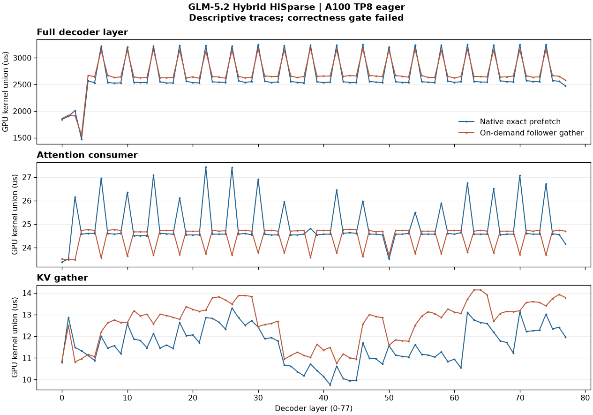

# GLM-5.2 精确预取与按需换入

2026 年 11 月 26 日在 8 张 A100 上跑完两臂。模型为 GLM-5.2-AWQ-INT4，后端为 vLLM Hybrid HiSparse 的 SM80 eager 适配，合计 78 层、21 个索引组。两臂采用同一个模型视图、同一组封存 agent 输入、同一显存配置。原生臂提前为组内后续层换入，按需臂到对应层再换入。固定输入长度为 4679、4679、10521 token，生成长度为 4、16、16 token。

## 时间线看到了什么

两臂各有 23 个覆盖全部 8 rank 的已标记 forward。用相同有序请求、相同已消费 token 历史、相同 rank 和完整 78 层绑定，得到 **5 个 B1 forward 和 0 个 B2 forward**。下表基于这 5 个 B1 forward 的各 rank、各层记录。时间为中位数。

| 观测量 | 原生精确预取 | 按需换入 | 配对层记录 |
| --- | ---: | ---: | ---: |
| 后续层 KV 换入结束到 attention 消费开始 | **5,728.004 µs** | **2.400 µs** | 2,280 |
| 组首及独立层 KV 换入结束到 attention 消费开始 | 2.944 µs | 2.400 µs | 840 |
| 后续层换入核 GPU 区间并集 | 12.255 µs | 13.759 µs | 2,280 |
| 后续层 attention 消费核 GPU 区间并集 | 24.574 µs | 24.703 µs | 2,280 |

在这 5 个 B1 forward 里，精确预取把后续层的换入提前到 attention 消费前约 5.73 ms，组首保持微秒量级。这个间隔衡量 KV 提前就绪的时间。未测出 attention 在按需臂上暴露的真实等待，也无法用这个间隔推算整步或服务加速。

图使用各臂独立观测到的 forward，汇总各层的 GPU 核区间并集中位数。图中三个区间有包含关系，数值无法相加，也不能读取两条曲线的间距作为预取得失。[逐层汇总](arm-profile.json) · [B1 同历史诊断](prefix-b1-timing.json)

## 正式配对状态

两臂都完成请求并实际发生混合卸载、页回收和 KV 换入。三条请求的完整生成结果均不一致，公共生成前缀分别只有 **2、2、3 token**。8 rank 的汇总 miss 与载荷计数也不同。严格的正确性及 Nsight 配对门禁因此拒绝全段计时。现有证据能确认真实模型上后续层换入确实发生了提前，关于端到端收益、输出分歧根因与 B2 的量化结论仍需要独立验证。

本轮保留了两份 Nsight Systems 原始报告，大小分别为 119,677,906 与 118,725,380 字节。共享盘仅存自有目录中的加密归档，解密后已逐文件对照源数据。04:26:34 自有 GPU 容器已停止。仅用于加速加载的 15 个临时权重副本也已释放，原始模型全程只读。

